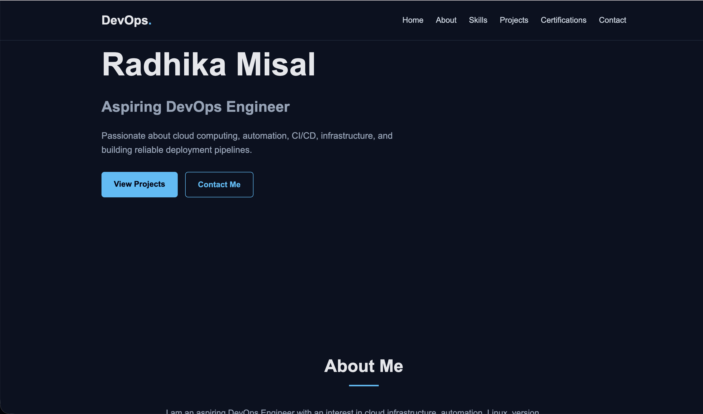

# 🚀 DevOps Portfolio

Welcome to my **DevOps Portfolio** 👋

This portfolio showcases my DevOps skills, projects, certification, education, resume, and hands-on learning journey in **DevOps and Cloud Engineering**.

## 👨‍💻 About Me

I am an aspiring **DevOps Engineer** with a strong interest in **Cloud Computing, Automation, CI/CD, and Infrastructure Management**.

I am continuously developing my technical skills through hands-on projects and practical learning with modern DevOps tools and technologies.

My goal is to build a strong career in **DevOps and Cloud Engineering** and contribute to real-world infrastructure and automation projects.

## 🛠️ Technical Skills

### ☁️ Cloud
- AWS
- Amazon EC2
- Amazon S3
- AWS CloudWatch
- IAM
- VPC

### 🔧 DevOps & CI/CD
- Git
- GitHub
- GitLab
- Bitbucket
- Jenkins
- CI/CD
- Docker
- Kubernetes
- Terraform
- Ansible

### 🐧 Operating Systems
- Linux
- Ubuntu
- Amazon Linux

### 📊 Monitoring
- Grafana
- AWS CloudWatch

### 🌐 Other Technologies
- Networking
- Reverse Proxy
- LEMP Stack
- SQL
- MariaDB
- Maven

### 💻 Web Technologies
- HTML
- CSS
- PHP

## 📂 Portfolio Sections

This portfolio contains:

- 👤 About Me
- 🛠️ Skills
- 🚀 Projects
- 🏆 Certifications
- 📄 Resume
- 📬 Contact

## 🚀 Projects

### 🔄 GitLab → GitHub Repository Mirroring

A hands-on DevOps project demonstrating repository synchronization between **GitLab and GitHub**.

#### Technologies Used

- Git
- GitLab
- GitHub
- SSH
- Repository Mirroring

#### What I Learned

- Git repository management
- GitLab repository mirroring
- GitHub repository management
- SSH authentication
- Git push and pull operations
- Working with remote repositories

## 🎓 Education

**Bachelor of Engineering (BE)**  
P.R. Pote Patil College of Engineering & Management, Amravati

**University:** Sant Gadge Baba Amravati University  
**Graduation Year:** 2025  
**CGPA:** 7.12

## 🏆 Certifications & Achievements

- **AWS Educate Badge** — AWS

## 📸 Portfolio Preview



## 💻 Run This Portfolio Locally

This portfolio can be opened using **VS Code and the Live Server extension**.

### Prerequisites

- VS Code
- Live Server extension
- Git

### Clone the Repository

```bash
git clone https://github.com/IAMRADHA/devops-portfolio.git
